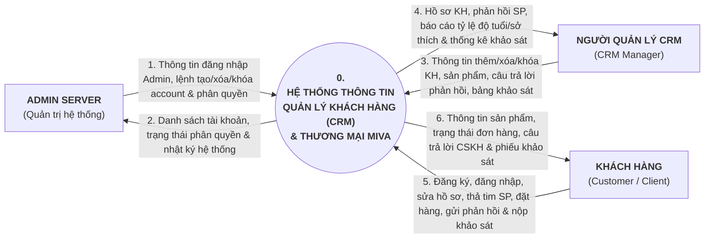
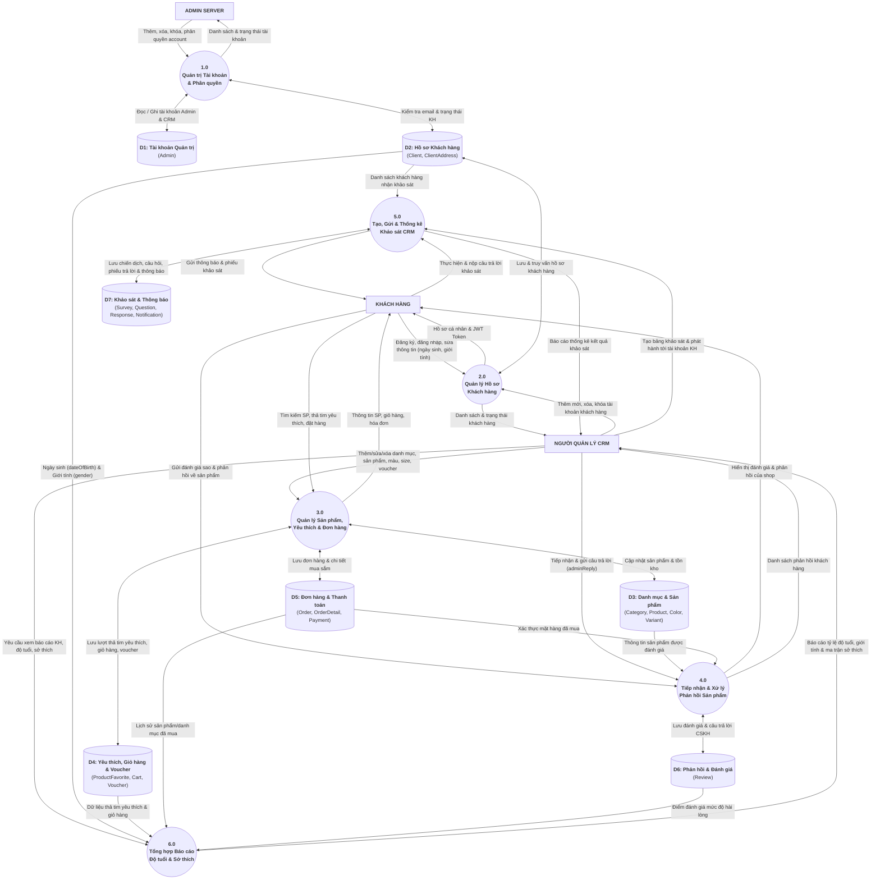

# Sơ đồ BFD, Sơ đồ Ngữ cảnh (DFD Mức 0) & Luồng Dữ liệu Mức Đỉnh (DFD Mức 1)

Tài liệu được chuẩn hóa theo đúng kiến trúc 3 tác nhân (**Admin Server**, **Người Quản lý CRM**, **Khách hàng**) và lược đồ CSDL `prisma/schema.prisma`.

## 1. Sơ đồ Chức năng Kinh doanh — BFD (Business Function Diagram) (2đ)

```mermaid
flowchart TD
    ROOT["<b>HỆ THỐNG THÔNG TIN QUẢN LÝ KHÁCH HÀNG (CRM)<br/>& THƯƠNG MẠI THỜI TRANG MIVA</b>"]

    F1["<b>1. Quản trị Hệ thống<br/>(Admin Server)</b>"]
    F2["<b>2. Quản lý Hồ sơ<br/>Khách hàng (CRM)</b>"]
    F3["<b>3. Quản lý Phản hồi &<br/>Khảo sát Khách hàng</b>"]
    F4["<b>4. Báo cáo & Phân tích<br/>Khách hàng (CRM Analytics)</b>"]
    F5["<b>5. Quản lý Danh mục, Sản phẩm<br/>& Giao dịch Thương mại</b>"]
    F6["<b>6. Cổng Dịch vụ<br/>Khách hàng (Client Portal)</b>"]

    ROOT --> F1
    ROOT --> F2
    ROOT --> F3
    ROOT --> F4
    ROOT --> F5
    ROOT --> F6

    F1 --> F1_1["1.1. Đăng nhập Admin Server tách biệt"]
    F1 --> F1_2["1.2. Thêm, sửa, xóa tài khoản hệ thống"]
    F1 --> F1_3["1.3. Phân quyền vai trò (SUPER_ADMIN / CRM_MANAGER)"]
    F1 --> F1_4["1.4. Sao lưu & Phục hồi CSDL"]

    F2 --> F2_1["2.1. Thêm mới hồ sơ khách hàng"]
    F2 --> F2_2["2.2. Tra cứu, lọc & cập nhật thông tin KH"]
    F2 --> F2_3["2.3. Khóa / Mở khóa tài khoản khách hàng"]
    F2 --> F2_4["2.4. Xóa tài khoản khách hàng"]

    F3 --> F3_1["3.1. Tiếp nhận đánh giá & phản hồi sản phẩm"]
    F3 --> F3_2["3.2. Trả lời phản hồi của khách hàng"]
    F3 --> F3_3["3.3. Tạo bảng khảo sát & phát hành tới KH"]
    F3 --> F3_4["3.4. Thống kê kết quả khảo sát"]

    F4 --> F4_1["4.1. Thống kê tỷ lệ độ tuổi & độ tuổi trung bình"]
    F4 --> F4_2["4.2. Thống kê cơ cấu giới tính khách hàng"]
    F4 --> F4_3["4.3. Phân tích sở thích theo lượt yêu thích & mua sắm"]
    F4 --> F4_4["4.4. Ma trận sở thích danh mục theo từng độ tuổi"]

    F5 --> F5_1["5.1. Quản lý Danh mục quần áo"]
    F5 --> F5_2["5.2. Quản lý Sản phẩm, Màu sắc, Size & Tồn kho"]
    F5 --> F5_3["5.3. Quản lý Đơn hàng & Thanh toán"]
    F5 --> F5_4["5.4. Quản lý Mã giảm giá (Voucher)"]

    F6 --> F6_1["6.1. Đăng ký, Đăng nhập & Chỉnh sửa hồ sơ"]
    F6 --> F6_2["6.2. Xem sản phẩm, Thả tim yêu thích & Đặt hàng"]
    F6 --> F6_3["6.3. Gửi phản hồi / đánh giá về sản phẩm"]
    F6 --> F6_4["6.4. Nhận thông báo & Thực hiện khảo sát"]
```

## 2. Sơ đồ Ngữ cảnh — Context Diagram (DFD Mức 0) (2đ)

## 3. Sơ đồ Luồng Dữ liệu Mức Đỉnh — Top-Level DFD (DFD Mức 1) (4đ)

