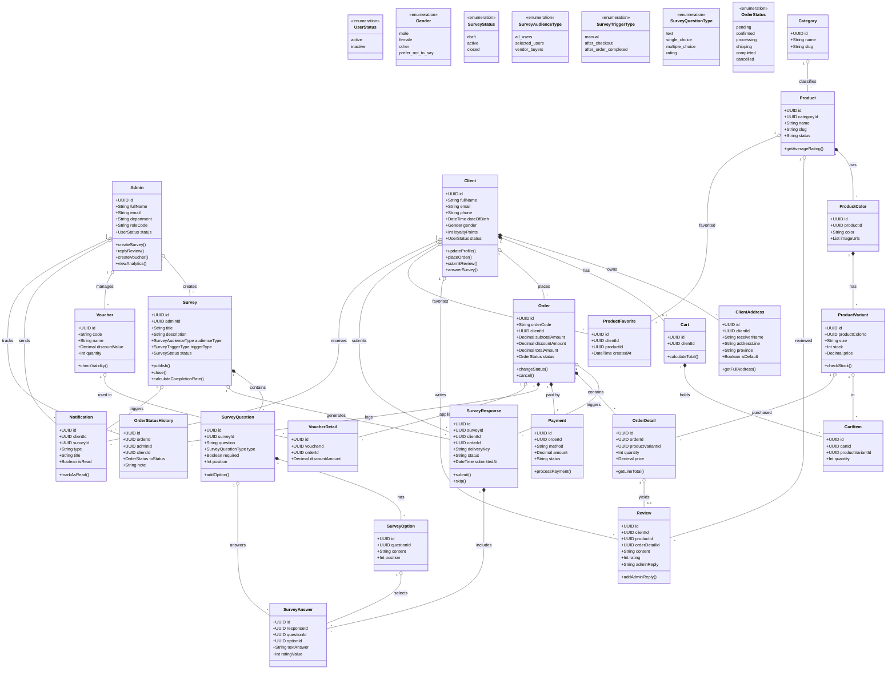

# Sơ đồ Lớp UML Hệ thống CRM (CRM Class Diagram)

Tài liệu này cung cấp toàn bộ mã nguồn biểu đồ lớp UML (UML Class Diagram) cho hệ thống **HTTTDN - CRM**, bám sát 100% cơ sở dữ liệu (`prisma/schema.prisma`) và kiến trúc phân lớp NestJS (`backend/src/app`).

---

## 1. Sơ đồ Lớp Thực thể Miền Dữ liệu (Domain Model Class Diagram - PlantUML)

Sơ đồ này mô tả 23 thực thể được phân theo 5 phân hệ chính của hệ thống CRM:
- **Người dùng & Xác thực**: `Admin`, `Client`, `ClientAddress`
- **Khảo sát & Thông báo (Core CRM)**: `Survey`, `SurveyQuestion`, `SurveyOption`, `SurveyResponse`, `SurveyAnswer`, `Notification`
- **Phản hồi & Sở thích (Core CRM)**: `Review`, `ProductFavorite`
- **Sản phẩm & Danh mục (Catalog)**: `Category`, `Product`, `ProductColor`, `ProductVariant`
- **Đơn hàng, Khuyến mãi & Giỏ hàng**: `Order`, `OrderDetail`, `Payment`, `OrderStatusHistory`, `Voucher`, `VoucherDetail`, `Cart`, `CartItem`

```plantuml
@startuml CRM_Domain_Class_Diagram
!theme plain
skinparam classAttributeIconSize 0
skinparam roundcorner 8
skinparam linetype ortho
skinparam nodesep 60
skinparam ranksep 60

skinparam package {
    BackgroundColor #F8F9FA
    BorderColor #6C757D
    FontStyle bold
}

skinparam class {
    BackgroundColor #FFFFFF
    BorderColor #2B579A
    HeaderBackgroundColor #2B579A
    FontColor #000000
    FontSize 12
    ArrowColor #1D3557
}

' ==========================================
' ENUMS
' ==========================================
package "Định nghĩa Kiểu Dữ liệu (Enums)" #EBF2FA {
    enum UserStatus {
        active
        inactive
    }

    enum Gender {
        male
        female
        other
        prefer_not_to_say
    }

    enum SurveyStatus {
        draft
        active
        closed
    }

    enum SurveyScope {
        platform
        vendor
    }

    enum SurveyAudienceType {
        all_users
        all_vendors
        all_system
        selected_users
        vendor_buyers
        vendor_completed_buyers
        vendor_product_buyers
    }

    enum SurveyTriggerType {
        manual
        after_checkout
        after_order_completed
    }

    enum SurveyResponseStatus {
        pending
        submitted
        skipped
        expired
    }

    enum SurveyQuestionType {
        text
        single_choice
        multiple_choice
        rating
    }

    enum NotificationType {
        survey_invitation
        order_update
        system
    }

    enum VoucherStatus {
        draft
        active
        inactive
        expired
    }

    enum VoucherScope {
        platform
        vendor
    }

    enum DiscountType {
        percentage
        fixed_amount
    }

    enum ProductStatus {
        draft
        active
        inactive
    }

    enum OrderStatus {
        pending
        confirmed
        processing
        shipping
        completed
        cancelled
    }

    enum PaymentMethod {
        cod
        vnpay
        momo
        zalopay
        bank_transfer
        credit_card
        pay_later
    }

    enum PaymentStatus {
        pending
        paid
        failed
        cancelled
        refunded
    }
}

' ==========================================
' PACKAGE 1: USERS & AUTH
' ==========================================
package "1. Quản lý Người dùng & Xác thực" #F4F6F9 {
    class Admin {
        - id: UUID
        + fullName: String
        + email: String
        - password: String
        + phone: String
        + avatarUrl: String
        + department: String
        + roleCode: String
        + permissions: Json
        + status: UserStatus
        + createdAt: DateTime
        + updatedAt: DateTime
        + deletedAt: DateTime
        --
        + createSurvey(dto: CreateSurveyDto): Survey
        + replyReview(reviewId: UUID, reply: String): Review
        + createVoucher(dto: CreateVoucherDto): Voucher
        + updateOrderStatus(orderId: UUID, status: OrderStatus): void
        + viewCustomerAnalytics(): CustomerReport
    }

    class Client {
        - id: UUID
        + fullName: String
        + email: String
        - password: String
        + phone: String
        + avatarUrl: String
        + dateOfBirth: DateTime
        + gender: Gender
        + loyaltyPoints: Int
        + status: UserStatus
        + createdAt: DateTime
        + updatedAt: DateTime
        + deletedAt: DateTime
        --
        + updateProfile(dto: UpdateClientDto): void
        + placeOrder(cart: Cart): Order
        + submitReview(productId: UUID, rating: Int, content: String): Review
        + answerSurvey(responseId: UUID, answers: List): SurveyResponse
        + addFavoriteProduct(productId: UUID): void
    }

    class ClientAddress {
        - id: UUID
        - clientId: UUID
        + receiverName: String
        + phone: String
        + addressLine: String
        + ward: String
        + district: String
        + province: String
        + label: String
        + isDefault: Boolean
        + createdAt: DateTime
        + updatedAt: DateTime
        + deletedAt: DateTime
        --
        + getFullAddress(): String
        + setDefault(isDefault: Boolean): void
    }
}

' ==========================================
' PACKAGE 2: SURVEYS & NOTIFICATIONS (CORE CRM)
' ==========================================
package "2. Phân hệ Khảo sát & Thông báo (Core CRM)" #E8F8F5 {
    class Survey {
        - id: UUID
        - adminId: UUID
        + title: String
        + description: String
        + imageUrl: String
        + scope: SurveyScope
        + audienceType: SurveyAudienceType
        + recipientIds: UUID[]
        + triggerType: SurveyTriggerType
        + status: SurveyStatus
        + startDate: DateTime
        + endDate: DateTime
        + createdAt: DateTime
        + updatedAt: DateTime
        + deletedAt: DateTime
        --
        + publish(): void
        + close(): void
        + addQuestion(q: SurveyQuestion): void
        + calculateCompletionRate(): Float
        + getStatistics(): SurveyStats
    }

    class SurveyQuestion {
        - id: UUID
        - surveyId: UUID
        + question: String
        + type: SurveyQuestionType
        + required: Boolean
        + position: Int
        + createdAt: DateTime
        + updatedAt: DateTime
        --
        + addOption(content: String, position: Int): SurveyOption
        + validateAnswer(answer: SurveyAnswer): Boolean
    }

    class SurveyOption {
        - id: UUID
        - questionId: UUID
        + content: String
        + position: Int
        + createdAt: DateTime
        --
        + getSelectionCount(): Int
    }

    class SurveyResponse {
        - id: UUID
        - surveyId: UUID
        - clientId: UUID
        - orderId: UUID
        + deliveryKey: String
        + status: SurveyResponseStatus
        + notifiedAt: DateTime
        + openedAt: DateTime
        + submittedAt: DateTime
        + skippedAt: DateTime
        + expiresAt: DateTime
        + createdAt: DateTime
        + updatedAt: DateTime
        --
        + markAsOpened(): void
        + submit(answers: List): void
        + skip(): void
    }

    class SurveyAnswer {
        - id: UUID
        - responseId: UUID
        - questionId: UUID
        - optionId: UUID
        + textAnswer: String
        + ratingValue: Int
        + createdAt: DateTime
        --
        + getFormattedValue(): Object
    }

    class Notification {
        - id: UUID
        - adminId: UUID
        - clientId: UUID
        - surveyId: UUID
        - surveyResponseId: UUID
        + type: NotificationType
        + title: String
        + content: String
        + data: Json
        + isRead: Boolean
        + readAt: DateTime
        + expiresAt: DateTime
        + createdAt: DateTime
        --
        + markAsRead(): void
    }
}

' ==========================================
' PACKAGE 3: FEEDBACK & INTERESTS (CORE CRM)
' ==========================================
package "3. Phản hồi Đánh giá & Sở thích Khách hàng (Core CRM)" #FEF9E7 {
    class Review {
        - id: UUID
        - clientId: UUID
        - productId: UUID
        - orderDetailId: UUID
        + content: String
        + rating: Int
        + adminReply: String
        + repliedAt: DateTime
        + createdAt: DateTime
        + updatedAt: DateTime
        + deletedAt: DateTime
        --
        + addAdminReply(reply: String): void
        + isVerifiedPurchase(): Boolean
    }

    class ProductFavorite {
        - id: UUID
        - clientId: UUID
        - productId: UUID
        + createdAt: DateTime
        --
        + trackInterestScore(): void
    }
}

' ==========================================
' PACKAGE 4: CATALOG & PRODUCTS
' ==========================================
package "4. Danh mục & Sản phẩm Nền tảng" #F5EEF8 {
    class Category {
        - id: UUID
        + name: String
        + slug: String
        + createdAt: DateTime
        + updatedAt: DateTime
        + deletedAt: DateTime
        --
        + getActiveProductCount(): Int
    }

    class Product {
        - id: UUID
        - categoryId: UUID
        + name: String
        + slug: String
        + description: String
        + status: ProductStatus
        + createdAt: DateTime
        + updatedAt: DateTime
        + deletedAt: DateTime
        --
        + getAverageRating(): Float
        + checkAvailability(): Boolean
    }

    class ProductColor {
        - id: UUID
        - productId: UUID
        + color: String
        + imageUrls: String[]
        + createdAt: DateTime
        + updatedAt: DateTime
        + deletedAt: DateTime
        --
        + getPrimaryImage(): String
    }

    class ProductVariant {
        - id: UUID
        - productColorId: UUID
        + size: String
        + stock: Int
        + price: Decimal
        + createdAt: DateTime
        + updatedAt: DateTime
        + deletedAt: DateTime
        --
        + checkStock(qty: Int): Boolean
        + deductStock(qty: Int): void
    }
}

' ==========================================
' PACKAGE 5: ORDERS, PROMOTIONS & CART
' ==========================================
package "5. Đơn hàng, Khuyến mãi & Giỏ hàng" #FDEDEC {
    class Order {
        - id: UUID
        + orderCode: String
        - clientId: UUID
        + subtotalAmount: Decimal
        + discountAmount: Decimal
        + shippingFee: Decimal
        + totalAmount: Decimal
        + status: OrderStatus
        + notes: String
        + receiverName: String
        + receiverPhone: String
        + shippingAddress: String
        + createdAt: DateTime
        + updatedAt: DateTime
        + cancelledAt: DateTime
        --
        + recalculateTotal(): Decimal
        + changeStatus(newStatus: OrderStatus, actorId: UUID): void
        + cancel(reason: String): void
    }

    class OrderDetail {
        - id: UUID
        - orderId: UUID
        - productVariantId: UUID
        + quantity: Int
        + price: Decimal
        + productName: String
        + colorName: String
        + sizeName: String
        + imageUrl: String
        --
        + getLineTotal(): Decimal
    }

    class Payment {
        - id: UUID
        - orderId: UUID
        + method: PaymentMethod
        + amount: Decimal
        + status: PaymentStatus
        + transactionCode: String
        + gateway: String
        + gatewayResponse: Json
        + paidAt: DateTime
        + refundedAt: DateTime
        + failedAt: DateTime
        + createdAt: DateTime
        + updatedAt: DateTime
        --
        + markAsPaid(transactionCode: String): void
        + processRefund(): void
    }

    class OrderStatusHistory {
        - id: UUID
        - orderId: UUID
        - adminId: UUID
        - clientId: UUID
        + fromStatus: OrderStatus
        + toStatus: OrderStatus
        + note: String
        + createdAt: DateTime
        --
        + logStatusChange(): void
    }

    class Voucher {
        - id: UUID
        - adminId: UUID
        + code: String
        + name: String
        + scope: VoucherScope
        + discountType: DiscountType
        + discountValue: Decimal
        + minOrderAmount: Decimal
        + maxDiscountAmount: Decimal
        + quantity: Int
        + usedQuantity: Int
        + perUserLimit: Int
        + startDate: DateTime
        + endDate: DateTime
        + status: VoucherStatus
        + createdAt: DateTime
        + updatedAt: DateTime
        + deletedAt: DateTime
        --
        + checkValidity(orderAmount: Decimal): Boolean
        + computeDiscount(orderAmount: Decimal): Decimal
    }

    class VoucherDetail {
        - id: UUID
        - voucherId: UUID
        - productId: UUID
        - orderId: UUID
        + eligibleAmount: Decimal
        + discountAmount: Decimal
        + sequence: Int
        + createdAt: DateTime
        + reversedAt: DateTime
        --
        + applyDiscount(): void
        + rollbackDiscount(): void
    }

    class Cart {
        - id: UUID
        - clientId: UUID
        + createdAt: DateTime
        + updatedAt: DateTime
        + deletedAt: DateTime
        --
        + getSubtotal(): Decimal
        + clearCart(): void
    }

    class CartItem {
        - id: UUID
        - productVariantId: UUID
        - cartId: UUID
        + quantity: Int
        + createdAt: DateTime
        + updatedAt: DateTime
        --
        + getPrice(): Decimal
        + updateQuantity(qty: Int): void
    }
}

' ==========================================
' RELATIONSHIPS & MULTIPLICITY
' ==========================================

' User relationships
Client "1" *-- "0..*" ClientAddress : owns
Client "1" *-- "0..1" Cart : possesses
Client "1" o-- "0..*" Order : places
Client "1" o-- "0..*" Review : authors
Client "1" o-- "0..*" ProductFavorite : saves
Client "1" o-- "0..*" SurveyResponse : completes
Client "1" o-- "0..*" Notification : receives
Client "1" o-- "0..*" OrderStatusHistory : triggers

Admin "1" o-- "0..*" Survey : manages
Admin "1" o-- "0..*" Voucher : configures
Admin "1" o-- "0..*" Notification : dispatches
Admin "1" o-- "0..*" OrderStatusHistory : updates

' Survey & Notification relationships
Survey "1" *-- "1..*" SurveyQuestion : contains
SurveyQuestion "1" *-- "0..*" SurveyOption : defines
Survey "1" o-- "0..*" SurveyResponse : collects
SurveyResponse "1" *-- "1..*" SurveyAnswer : includes
SurveyQuestion "1" o-- "0..*" SurveyAnswer : validates
SurveyOption "1" o-- "0..*" SurveyAnswer : selected in
Survey "1" o-- "0..*" Notification : generates
SurveyResponse "1" o-- "0..1" Notification : triggers
Order "1" o-- "0..*" SurveyResponse : triggers post-order

' Catalog & Product relationships
Category "1" o-- "0..*" Product : categorizes
Product "1" *-- "1..*" ProductColor : features
ProductColor "1" *-- "1..*" ProductVariant : provides
Product "1" o-- "0..*" Review : receives
Product "1" o-- "0..*" ProductFavorite : favorited by
Product "1" o-- "0..*" VoucherDetail : scoped in

' Cart & Order relationships
Cart "1" *-- "0..*" CartItem : contains
ProductVariant "1" o-- "0..*" CartItem : referenced in
Order "1" *-- "1..*" OrderDetail : comprises
ProductVariant "1" o-- "0..*" OrderDetail : ordered in
OrderDetail "1" o-- "0..1" Review : generates review
Order "1" *-- "1" Payment : settled by
Order "1" *-- "1..*" OrderStatusHistory : tracks
Order "1" o-- "0..*" VoucherDetail : applies
Voucher "1" o-- "0..*" VoucherDetail : records usage

@enduml
```

---

## 2. Sơ đồ Lớp Thực thể Miền Dữ liệu (Mermaid Class Diagram)

Biểu đồ này có thể render trực tiếp trên GitHub, GitLab, VS Code Markdown Preview:

---

## 3. Sơ đồ Lớp Kiến trúc Phần mềm NestJS (Software Architecture Class Diagram)

Sơ đồ mô tả thiết kế hướng đối tượng theo mô hình phân tầng chuẩn của NestJS Backend: **Controllers -> Services -> PrismaService (ORM / Database Access Layer)**.

```plantuml
@startuml NestJS_Software_Architecture_Class_Diagram
!theme plain
skinparam classAttributeIconSize 0
skinparam roundcorner 5

package "Tầng Trình diễn (Controllers Layer)" #D6EAF8 {
    class SurveysController {
        - surveysService: SurveysService
        + create(dto: CreateSurveyDto, user: UserInfo): Promise
        + getTemplates(target: String): Promise
        + listMine(user: UserInfo, query: GetSurveysQueryDto): Promise
        + listAll(query: GetSurveysQueryDto): Promise
        + listInbox(user: UserInfo, query: GetSurveyInboxQueryDto): Promise
        + getInboxDetail(responseId: UUID, user: UserInfo): Promise
        + submitSurvey(responseId: UUID, dto: SubmitSurveyDto, user: UserInfo): Promise
        + updateStatus(id: UUID, dto: SurveyStatusDto, user: UserInfo): Promise
        + getResults(id: UUID, query: GetSurveyResultsQueryDto): Promise
    }

    class ClientsController {
        - clientsService: ClientsService
        + getClients(query: GetClientsPaginationDto): Promise
        + getProfile(client: UserInfo): Promise
        + updateProfile(client: UserInfo, dto: UpdateClientProfileDto): Promise
        + updateClientStatus(id: UUID, dto: UpdateClientDto): Promise
        + softDeleteClient(id: UUID): Promise
    }

    class ReviewsController {
        - reviewsService: ReviewsService
        + createReview(dto: CreateReviewDto, user: UserInfo): Promise
        + replyReview(id: UUID, dto: ReplyReviewDto, user: UserInfo): Promise
        + listReviews(query: GetReviewsQueryDto): Promise
    }

    class ReportsController {
        - reportsService: ReportsService
        + adminCustomers(query: CustomerReportQueryDto, user: UserInfo): Promise
        + adminAnalytics(query: AnalyticsReportQueryDto): Promise
        + reconciliation(query: ReconciliationQueryDto): Promise
    }

    class OrdersController {
        - ordersService: OrdersService
        + createOrder(dto: CreateOrderDto, user: UserInfo): Promise
        + getMyOrders(user: UserInfo, query: PaginationDto): Promise
        + updateStatus(id: UUID, dto: UpdateOrderStatusDto, user: UserInfo): Promise
    }

    class AdminsController {
        - adminsService: AdminsService
        + getAdmins(query: PaginationDto): Promise
        + updateRole(id: UUID, dto: UpdateAdminRoleDto): Promise
    }
}

package "Tầng Nghiệp vụ (Services Layer)" #D5F5E3 {
    class SurveysService {
        - prisma: PrismaService
        + create(dto: CreateSurveyDto, user: UserInfo): Promise
        + getTemplates(target: String): List
        + listMine(user: UserInfo, query: GetSurveysQueryDto): Promise
        + listAll(query: GetSurveysQueryDto): Promise
        + listInbox(user: UserInfo, query: GetSurveyInboxQueryDto): Promise
        + getInboxDetail(responseId: UUID, user: UserInfo): Promise
        + submitSurvey(responseId: UUID, dto: SubmitSurveyDto, user: UserInfo): Promise
        + updateStatus(id: UUID, dto: SurveyStatusDto, user: UserInfo): Promise
        + computeSurveyMetrics(surveyId: UUID): Promise
        + triggerPostOrderSurvey(orderId: UUID, clientId: UUID): Promise
    }

    class ClientsService {
        - prisma: PrismaService
        + getClients(query: GetClientsPaginationDto): Promise
        + getClient(filter: Object): Promise
        + updateClient(id: UUID, dto: UpdateClientDto): Promise
        + softDelete(id: UUID): Promise
    }

    class ReviewsService {
        - prisma: PrismaService
        + createReview(dto: CreateReviewDto, clientId: UUID): Promise
        + replyReview(reviewId: UUID, adminId: UUID, reply: String): Promise
        + getCustomerFeedbackSentiment(): Promise
    }

    class ReportsService {
        - prisma: PrismaService
        + customerReport(user: UserInfo, query: CustomerReportQueryDto): Promise
        + getCustomerAgeDistribution(): Promise
        + getCustomerInterestPreferences(): Promise
        + analyticsOverview(query: AnalyticsReportQueryDto): Promise
    }

    class OrdersService {
        - prisma: PrismaService
        + createOrder(dto: CreateOrderDto, clientId: UUID): Promise
        + updateStatus(orderId: UUID, status: OrderStatus, actor: UserInfo): Promise
    }

    class AdminsService {
        - prisma: PrismaService
        + getAdmins(query: PaginationDto): Promise
        + updateAdmin(id: UUID, dto: UpdateAdminDto): Promise
    }
}

package "Tầng Dữ liệu (Persistence / ORM Layer)" #FCF3CF {
    class PrismaService {
        + admin: AdminDelegate
        + client: ClientDelegate
        + survey: SurveyDelegate
        + surveyQuestion: SurveyQuestionDelegate
        + surveyResponse: SurveyResponseDelegate
        + review: ReviewDelegate
        + product: ProductDelegate
        + order: OrderDelegate
        + voucher: VoucherDelegate
        + $connect(): Promise<void>
        + $disconnect(): Promise<void>
        + $transaction(fn: Function): Promise
    }
}

' Liên kết giữa các lớp
SurveysController --> SurveysService : delegates
ClientsController --> ClientsService : delegates
ReviewsController --> ReviewsService : delegates
ReportsController --> ReportsService : delegates
OrdersController --> OrdersService : delegates
AdminsController --> AdminsService : delegates

SurveysService --> PrismaService : queries
ClientsService --> PrismaService : queries
ReviewsService --> PrismaService : queries
ReportsService --> PrismaService : queries
OrdersService --> PrismaService : queries
AdminsService --> PrismaService : queries

@enduml
```

