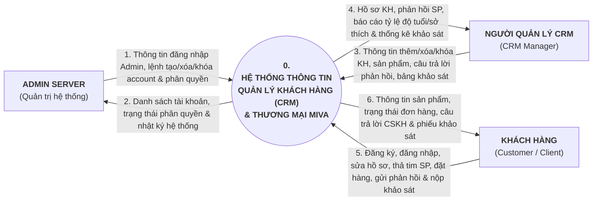
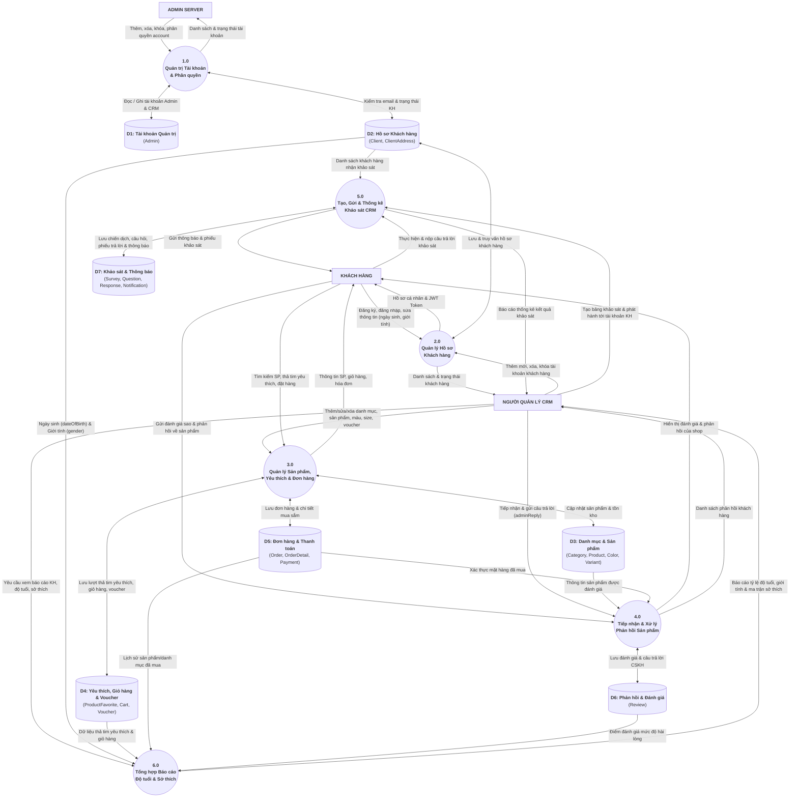
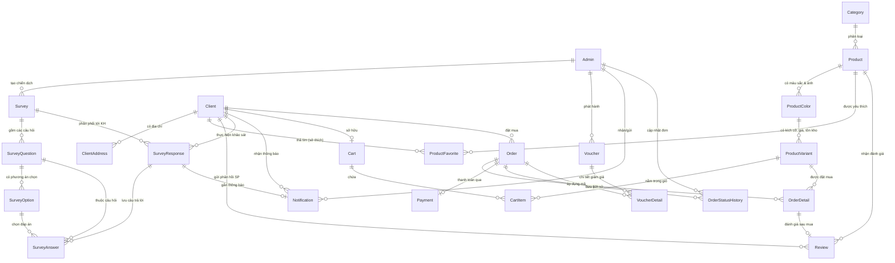

# BÁO CÁO ĐỒ ÁN GIỮA KỲ — HỆ THỐNG THÔNG TIN QUẢN LÝ KHÁCH HÀNG (CRM) & KẾT QUẢ KIỂM THỬ

- **Trường:** Đại học Sài Gòn — Khoa Công Nghệ Thông Tin
- **Học phần:** Hệ thống thông tin doanh nghiệp (`841065`)
- **Tên đề tài:** Xây dựng Hệ thống thông tin Quản lý Quan hệ Khách hàng (CRM) tích hợp Website Thương mại Thời trang MIVA

---

## PHẦN I. KHẢO SÁT, PHÂN TÍCH & THIẾT KẾ HỆ THỐNG THÔNG TIN (40 ĐIỂM)

### 1. Giới thiệu Doanh nghiệp & Khảo sát HTTT (Mục I.1 — 10 điểm)

#### 1.1. Giới thiệu chung về Doanh nghiệp Thời trang MIVA (5đ)
- **Tên doanh nghiệp:** Thương hiệu Thời trang Thương mại Điện tử MIVA Fashion.
- **Lĩnh vực hoạt động:** Kinh doanh bán lẻ trực tuyến các dòng sản phẩm quần áo thời trang nam/nữ (Áo Thun, Áo Polo, Sơ mi Công sở, Áo Khoác, Quần Jeans/Kaki, Đầm/Váy và Phụ kiện).
- **Cơ cấu tổ chức & Các tác nhân (Actors) tham gia vào Hệ thống thông tin:**
  1. **Quản trị Hệ thống (`Admin Server` — `SUPER_ADMIN`):** Cấp phát tài khoản, gán vai trò qua `roleCode`, khóa/mở khóa/xóa tài khoản và sử dụng script sao lưu/phục hồi cơ sở dữ liệu.
  2. **Người Quản lý CRM (`CRM Manager` — `CRM_MANAGER`):** Quản lý hồ sơ khách hàng, tiếp nhận và phản hồi đánh giá sản phẩm, tạo bảng khảo sát thăm dò thị hiếu khi ra mắt bộ sưu tập mới, thống kê kết quả khảo sát, xem báo cáo nhân khẩu học (tỷ lệ độ tuổi, giới tính) & sở thích mua sắm, đồng thời quản lý danh mục, sản phẩm (màu sắc, kích cỡ, tồn kho), đơn hàng và mã giảm giá.
  3. **Khách hàng (`Client / Customer`):** Người tiêu dùng đăng ký tài khoản, đăng nhập, chỉnh sửa hồ sơ cá nhân (ngày sinh, giới tính, địa chỉ), tìm kiếm/mua sắm sản phẩm, thả tim sản phẩm yêu thích, gửi phản hồi/đánh giá về sản phẩm và nhận/thực hiện các bài khảo sát trực tuyến.

#### 1.2. Bảng 16 Câu hỏi Điều tra, Khảo sát Hiện trạng HTTT của Doanh nghiệp (5đ)
*(Khảo sát thực hiện trên 50 phiếu gồm nhân sự quản lý, nhân viên CSKH và khách hàng mua sắm tại MIVA)*

| STT | Câu hỏi khảo sát về Hệ thống thông tin (HTTT) | Các phương án trả lời | Kết quả (50 phiếu) |
| :-: | :--- | :--- | :--- |
| **1** | Hiện tại doanh nghiệp đang lưu trữ thông tin khách hàng mua quần áo bằng công cụ nào? | A. Sổ sách giấy tờ / Hóa đơn lẻ<br>B. File Excel / Google Sheets rời rạc<br>C. Phần mềm bán hàng cũ chưa có CRM<br>D. Hệ thống CRM tập trung | A: 12% \| **B: 64%** \| C: 24% \| D: 0% |
| **2** | Việc tra cứu lại lịch sử mua hàng, size áo/quần quen mặc của khách hàng cũ mất bao lâu? | A. Dưới 30 giây<br>B. Từ 1 – 3 phút<br>C. Hơn 5 phút (phải tìm trong nhiều file)<br>D. Không tra cứu được | A: 6% \| B: 20% \| **C: 52%** \| D: 22% |
| **3** | Doanh nghiệp có nắm được thống kê tỷ lệ độ tuổi và giới tính của tệp khách hàng hiện tại không? | A. Có biểu đồ thống kê tự động theo thời gian thực<br>B. Thống kê thủ công định kỳ bằng Excel<br>C. Chỉ ước lượng cảm tính qua người bán<br>D. Hoàn toàn không có thông tin | A: 0% \| B: 18% \| **C: 62%** \| D: 20% |
| **4** | Khi khách hàng muốn xem các mẫu quần áo theo màu sắc và kích cỡ (`S, M, L, XL`) còn tồn kho, họ làm thế nào? | A. Xem trực tiếp tồn kho từng màu/size trên Website<br>B. Phải nhắn tin Fanpage/Zalo chờ nhân viên kiểm kho<br>C. Phải gọi điện thoại hỏi cửa hàng | A: 14% \| **B: 72%** \| C: 14% |
| **5** | Doanh nghiệp biết được khách hàng yêu thích danh mục hay mẫu quần áo nào bằng cách nào? | A. Hệ thống tự động thống kê lượt thả tim (Yêu thích) & lượt mua<br>B. Ghi chép thủ công các mẫu khách hay hỏi<br>C. Chỉ nhìn vào số lượng hàng tồn cuối tháng | A: 0% \| B: 32% \| **C: 68%** |
| **6** | Khi khách hàng có phản hồi/đánh giá về chất vải, đường may hoặc form áo, họ gửi qua đâu? | A. Gửi trực tiếp trên trang sản phẩm của Website<br>B. Bình luận rải rác trên Facebook / Zalo / Tin nhắn<br>C. Gọi điện phản ánh trực tiếp | A: 10% \| **B: 76%** \| C: 14% |
| **7** | Tình trạng bỏ sót hoặc phản hồi chậm các đánh giá/khiếu nại của khách hàng có thường xảy ra không? | A. Thường xuyên bị trôi tin nhắn, bỏ sót (>30%)<br>B. Thỉnh thoảng xảy ra khi vào mùa cao điểm sale<br>C. Hiếm khi xảy ra | **A: 56%** \| B: 36% \| C: 8% |
| **8** | Khi chuẩn bị ra mắt Bộ sưu tập quần áo mới, doanh nghiệp thăm dò ý kiến khách hàng bằng cách nào? | A. Tạo khảo sát trên hệ thống CRM & gửi thông báo tới tài khoản KH<br>B. Dùng Google Forms đăng lên mạng xã hội<br>C. Tự nhập hàng theo cảm tính, không khảo sát | A: 0% \| B: 28% \| **C: 72%** |
| **9** | Khó khăn lớn nhất khi khảo sát khách hàng bằng công cụ rời rạc (như Google Forms) là gì? | A. Khách hàng không nhận được thông báo trực tiếp<br>B. Không gắn kết được với tài khoản & lịch sử mua hàng của KH<br>C. Tốn thời gian tổng hợp biểu đồ thủ công<br>D. Tất cả các ý trên | A: 12% \| B: 16% \| C: 10% \| **D: 62%** |
| **10** | Việc cấp phát và kiểm tra điều kiện áp dụng Mã giảm giá (Voucher) cho khách hàng đang thực hiện thế nào? | A. Hệ thống tự động kiểm tra hạn dùng, giá trị đơn tối thiểu & trừ tiền<br>B. Nhân viên tự tính tay và trừ tiền thủ công trên hóa đơn<br>C. Chưa áp dụng mã giảm giá | A: 16% \| **B: 68%** \| C: 16% |
| **11** | Mức độ phân quyền giữa Quản trị kỹ thuật (Admin Server) và Người quản lý khách hàng (CRM) hiện tại ra sao? | A. Đã tách biệt rõ ràng 2 cổng đăng nhập và quyền hạn<br>B. Dùng chung 1 tài khoản quản trị cho tất cả mọi người<br>C. Phân quyền bằng lời nói, không kiểm soát trên phần mềm | A: 0% \| **B: 66%** \| C: 34% |
| **12** | Khi có tài khoản khách hàng vi phạm (bom hàng nhiều lần, spam), hệ thống hiện tại xử lý thế nào? | A. Khóa tài khoản (`inactive`) ngay trên hệ thống quản lý<br>B. Ghi chú số điện thoại vào danh sách đen trên Excel<br>C. Không kiểm soát được | A: 8% \| **B: 64%** \| C: 28% |
| **13** | Hiện trạng sao lưu và phục hồi Cơ sở dữ liệu (Backup & Restore) của doanh nghiệp đang thực hiện ra sao? | A. Có kịch bản sao lưu định kỳ tự động ra file `.dump`<br>B. Thỉnh thoảng copy thủ công file Excel sang USB<br>C. Chưa có phương án sao lưu dữ liệu | A: 0% \| **B: 58%** \| C: 42% |
| **14** | Thời gian lập báo cáo doanh thu, lợi nhuận và báo cáo khách hàng định kỳ mất bao lâu? | A. Xem tức thì trên Dashboard hệ thống<br>B. Mất 1 – 2 ngày tổng hợp từ nhiều file<br>C. Mất gần 1 tuần vào mỗi cuối tháng | A: 0% \| **B: 60%** \| C: 40% |
| **15** | Khách hàng mong muốn tính năng nào nhất trên Website bán quần áo mới của doanh nghiệp? | A. Xem rõ màu sắc/size, lưu sản phẩm yêu thích & áp voucher tự động<br>B. Gửi đánh giá sản phẩm trực tiếp & nhận phản hồi từ shop<br>C. Nhận thông báo khảo sát ưu đãi ngay trên tài khoản<br>D. Tất cả các tính năng trên | A: 18% \| B: 10% \| C: 8% \| **D: 64%** |
| **16** | Mức độ cấp thiết của việc xây dựng Hệ thống thông tin Quản lý Khách hàng (CRM) tích hợp Website thương mại? | A. Rất cấp thiết, cần triển khai ngay<br>B. Cần thiết trong 6 tháng tới<br>C. Chưa cần thiết | **A: 88%** \| B: 12% \| C: 0% |

#### 1.3. Tổng kết kết quả & Kết luận cho HTTT
- **Hạn chế của hệ thống cũ:** Dữ liệu khách hàng lưu trên Excel rời rạc (64%), không thống kê được tỷ lệ độ tuổi/sở thích (82%), phản hồi sản phẩm bị trôi trên mạng xã hội (56%), ra mắt sản phẩm mới theo cảm tính (72%) và chưa tách biệt quyền hạn giữa Admin Server và Quản lý CRM (66%).
- **Kết luận:** Xây dựng **HTTT Quản lý Khách hàng (CRM) tích hợp Website thương mại MIVA** với 3 tác nhân độc lập (*Admin Server*, *Người Quản lý CRM*, *Khách hàng*) trên nền tảng CSDL tập trung PostgreSQL.

---

### 2. Phân tích Hệ thống thông tin của Doanh nghiệp (Mục I.2 — 10 điểm)

#### 2.1. Mô tả chi tiết bài toán hoạt động của HTTT Doanh nghiệp (2đ)
Hệ thống thông tin Quản lý Khách hàng (CRM) tích hợp thương mại điện tử thời trang MIVA vận hành theo quy trình khép kín gồm 3 phân hệ nghiệp vụ:

1. **Nghiệp vụ Quản trị Hệ thống (Admin Server):**
   - Quản trị viên hệ thống đăng nhập qua cổng riêng biệt (`/login/admin`).
   - Thực hiện tạo mới tài khoản quản trị/nhân sự, cấp quyền truy cập (`SUPER_ADMIN` hoặc `CRM_MANAGER`), khóa/mở khóa hoặc xóa tài khoản vi phạm tại màn hình `/system/accounts`.
   - Quản lý an toàn dữ liệu thông qua cơ chế sao lưu (`pg_dump`) và phục hồi (`pg_restore`) cơ sở dữ liệu định kỳ.

2. **Nghiệp vụ Quản lý Quan hệ Khách hàng & Thương mại (Người Quản lý CRM):**
   - Người quản lý CRM đăng nhập tại cổng `/login/crm`.
   - **Quản lý hồ sơ khách hàng:** Thêm mới khách hàng, cập nhật thông tin nhân khẩu học (ngày sinh, giới tính, địa chỉ), khóa tài khoản khách hàng vi phạm (`inactive`) hoặc xóa mềm khách hàng.
   - **Quản lý danh mục & sản phẩm thời trang:** Thiết lập danh mục quần áo, thêm/sửa/xóa sản phẩm kèm đa biến thể Màu sắc (`ProductColor` + bộ ảnh) và Kích cỡ (`ProductVariant`: S, M, L, XL, giá bán, tồn kho).
   - **Tiếp nhận & xử lý phản hồi sản phẩm:** Xem toàn bộ đánh giá sao (1–5 sao) và nhận xét của khách hàng về chất liệu, form dáng sản phẩm; gửi phản hồi chính thức (`adminReply`) trực tiếp dưới đánh giá của khách.
   - **Khảo sát khách hàng (Survey Campaign):** Thiết kế bảng câu hỏi khảo sát (chọn 1 đáp án, chọn nhiều đáp án, chấm sao 1–5, tự luận) để đo lường độ hài lòng hoặc thăm dò ý kiến trước khi ra mắt bộ sưu tập mới; phát hành khảo sát tới toàn bộ khách hàng hoặc tệp khách hàng chọn lọc qua thông báo thời gian thực (Realtime Socket.IO); xem báo cáo thống kê kết quả khảo sát tự động.
   - **Báo cáo Khách hàng, Tỷ lệ Độ tuổi & Sở thích:** Hệ thống tự động tính tuổi từ ngày sinh (`dateOfBirth`) để phân nhóm độ tuổi (`<18`, `18–24`, `25–34`, `35–44`, `45–54`, `55+`), thống kê tỷ lệ giới tính và kết hợp dữ liệu hành vi (Lượt thả tim `ProductFavorite`, Lịch sử mua hàng `OrderDetail`, Giỏ hàng `CartItem`) để lập ma trận **Sở thích danh mục sản phẩm theo từng nhóm tuổi**.

3. **Nghiệp vụ Khách hàng (Client Storefront):**
   - Khách hàng truy cập Website thương mại, đăng ký tài khoản mới và đăng nhập.
   - Cập nhật thông tin cá nhân (họ tên, số điện thoại, ngày sinh, giới tính, ảnh đại diện, sổ địa chỉ).
   - Tra cứu sản phẩm theo danh mục/màu sắc/size, thả tim sản phẩm yêu thích, thêm vào giỏ hàng, áp mã giảm giá (Voucher) và đặt hàng.
   - Gửi đánh giá sao & phản hồi về sản phẩm; nhận thông báo khảo sát từ doanh nghiệp và thực hiện trả lời khảo sát trực tuyến.

---

#### 2.2. Sơ đồ Chức năng Kinh doanh — BFD (Business Function Diagram) (2đ)

```mermaid
flowchart TD
    ROOT["<b>HỆ THỐNG THÔNG TIN QUẢN LÝ KHÁCH HÀNG (CRM)<br/>& THƯƠNG MẠI THỜI TRANG MIVA</b>"]

    F1["<b>1. Quản trị Hệ thống<br/>(Admin Server)</b>"]
    F2["<b>2. Quản lý Hồ sơ<br/>Khách hàng (CRM)</b>"]
    F3["<b>3. Quản lý Phản hồi &<br/>Khảo sát Khách hàng</b>"]
    F4["<b>4. Báo cáo & Phân tích<br/>Khách hàng (CRM Analytics)</b>"]
    F5["<b>5. Quản lý Danh mục, Sản phẩm<br/>& Giao dịch Thương mại</b>"]
    F6["<b>6. Cổng Dịch vụ<br/>Khách hàng (Client Portal)</b>"]

    ROOT --> F1
    ROOT --> F2
    ROOT --> F3
    ROOT --> F4
    ROOT --> F5
    ROOT --> F6

    F1 --> F1_1["1.1. Đăng nhập Admin Server tách biệt"]
    F1 --> F1_2["1.2. Thêm, sửa, xóa tài khoản hệ thống"]
    F1 --> F1_3["1.3. Phân quyền vai trò (SUPER_ADMIN / CRM_MANAGER)"]
    F1 --> F1_4["1.4. Sao lưu & Phục hồi CSDL"]

    F2 --> F2_1["2.1. Thêm mới hồ sơ khách hàng"]
    F2 --> F2_2["2.2. Tra cứu, lọc & cập nhật thông tin KH"]
    F2 --> F2_3["2.3. Khóa / Mở khóa tài khoản khách hàng"]
    F2 --> F2_4["2.4. Xóa tài khoản khách hàng"]

    F3 --> F3_1["3.1. Tiếp nhận đánh giá & phản hồi sản phẩm"]
    F3 --> F3_2["3.2. Trả lời phản hồi của khách hàng"]
    F3 --> F3_3["3.3. Tạo bảng khảo sát & phát hành tới KH"]
    F3 --> F3_4["3.4. Thống kê kết quả khảo sát"]

    F4 --> F4_1["4.1. Thống kê tỷ lệ độ tuổi & độ tuổi trung bình"]
    F4 --> F4_2["4.2. Thống kê cơ cấu giới tính khách hàng"]
    F4 --> F4_3["4.3. Phân tích sở thích theo lượt yêu thích & mua sắm"]
    F4 --> F4_4["4.4. Ma trận sở thích danh mục theo từng độ tuổi"]

    F5 --> F5_1["5.1. Quản lý Danh mục quần áo"]
    F5 --> F5_2["5.2. Quản lý Sản phẩm, Màu sắc, Size & Tồn kho"]
    F5 --> F5_3["5.3. Quản lý Đơn hàng & Thanh toán"]
    F5 --> F5_4["5.4. Quản lý Mã giảm giá (Voucher)"]

    F6 --> F6_1["6.1. Đăng ký, Đăng nhập & Chỉnh sửa hồ sơ"]
    F6 --> F6_2["6.2. Xem sản phẩm, Thả tim yêu thích & Đặt hàng"]
    F6 --> F6_3["6.3. Gửi phản hồi / đánh giá về sản phẩm"]
    F6 --> F6_4["6.4. Nhận thông báo & Thực hiện khảo sát"]
```



---

#### 2.3. Sơ đồ Ngữ cảnh — Context Diagram (DFD Mức 0) (2đ)

Sơ đồ ngữ cảnh thể hiện biên giới của hệ thống (Tiến trình trung tâm `0. Hệ thống thông tin CRM & Thương mại MIVA`) và các luồng thông tin vào/ra với **3 Tác nhân ngoài (External Entities)**: **Admin Server**, **Người Quản lý CRM**, và **Khách hàng**.



---

#### 2.4. Sơ đồ Luồng Dữ liệu Mức Đỉnh — Top-Level DFD (DFD Mức 1) (4đ)

Phân rã Tiến trình `0` thành **6 Tiến trình nghiệp vụ chính (`1.0` đến `6.0`)** và **7 Kho dữ liệu chuẩn (`D1` đến `D7`)** làm cơ sở trực tiếp để thiết kế Cơ sở dữ liệu ở Mục 3:



##### Bảng Đặc tả 6 Tiến trình và 7 Kho dữ liệu trên DFD Mức Đỉnh

| Mã | Tên Tiến trình / Kho dữ liệu | Đầu vào (Input) | Đầu ra (Output) | Tác nhân / Bảng CSDL liên quan |
| :-: | :--- | :--- | :--- | :--- |
| **1.0** | Quản trị Tài khoản & Phân quyền | Lệnh thêm, xóa, khóa, phân quyền từ Admin Server | Danh sách tài khoản, token xác thực, quyền truy cập | `Admin`, `Client` |
| **2.0** | Quản lý Hồ sơ Khách hàng | Thông tin đăng ký/cập nhật từ KH; lệnh thêm/xóa/khóa KH từ CRM Manager | Hồ sơ khách hàng đã chuẩn hóa (gồm `dateOfBirth`, `gender`) | `Client`, `ClientAddress` |
| **3.0** | Quản lý Sản phẩm, Yêu thích & Đơn hàng | Thông tin SP/màu/size từ CRM Manager; lượt thả tim, giỏ hàng, đơn đặt hàng từ KH | Dữ liệu danh mục sản phẩm, trạng thái đơn hàng, lượt yêu thích | `Category`, `Product`, `ProductColor`, `ProductVariant`, `ProductFavorite`, `Cart`, `Order` |
| **4.0** | Tiếp nhận & Xử lý Phản hồi Sản phẩm | Điểm sao (`1-5`) và nội dung nhận xét từ KH; nội dung phản hồi (`adminReply`) từ CRM Manager | Danh sách phản hồi sản phẩm công khai kèm câu trả lời của doanh nghiệp | `Review` |
| **5.0** | Tạo, Gửi & Thống kê Khảo sát CRM | Cấu hình bảng khảo sát & câu hỏi từ CRM Manager; bài làm khảo sát từ KH | Thông báo khảo sát tới tài khoản KH; biểu đồ thống kê kết quả khảo sát | `Survey`, `SurveyQuestion`, `SurveyOption`, `SurveyResponse`, `SurveyAnswer`, `Notification` |
| **6.0** | Tổng hợp Báo cáo Độ tuổi & Sở thích | Đọc `dateOfBirth`, `gender` từ **D2**; lượt thả tim từ **D4**; lịch sử mua hàng từ **D5** | Báo cáo nhân khẩu học (6 nhóm tuổi, giới tính) & Ma trận sở thích danh mục theo độ tuổi | Báo cáo trực quan gửi tới **Người Quản lý CRM** |

---

### 3. Thiết kế Hệ thống thông tin (Mục I.3 — 10 điểm)

#### 3.1. Thiết kế Cơ sở dữ liệu (5đ)

##### A. Bảng Ánh xạ từ Kho dữ liệu (DFD Mức Đỉnh) sang các Bảng Vật lý trong CSDL
Lược đồ CSDL PostgreSQL (`htttdn_crm`) được thiết kế trực tiếp từ **7 Kho dữ liệu (`D1` – `D7`)** đã phân tích ở sơ đồ DFD Mức đỉnh:

| Mã Kho DL (DFD) | Tên Kho dữ liệu logic | Các Bảng vật lý tương ứng trong CSDL PostgreSQL (`schema.prisma`) |
| :-: | :--- | :--- |
| **D1** | Kho Tài khoản Quản trị | `Admin` (lưu cả `SUPER_ADMIN` và `CRM_MANAGER`) |
| **D2** | Kho Hồ sơ Khách hàng | `Client`, `ClientAddress` |
| **D3** | Kho Danh mục & Sản phẩm | `Category`, `Product`, `ProductColor`, `ProductVariant` |
| **D4** | Kho Yêu thích, Giỏ hàng & Voucher | `ProductFavorite`, `Cart`, `CartItem`, `Voucher`, `VoucherDetail` |
| **D5** | Kho Đơn hàng & Thanh toán | `Order`, `OrderDetail`, `Payment`, `OrderStatusHistory` |
| **D6** | Kho Phản hồi & Đánh giá | `Review` |
| **D7** | Kho Khảo sát & Thông báo CRM | `Survey`, `SurveyQuestion`, `SurveyOption`, `SurveyResponse`, `SurveyAnswer`, `Notification` |

##### B. Lược đồ Quan hệ Thực thể — ERD (Entity-Relationship Diagram)



##### C. Đặc tả Chi tiết các Bảng và Thuộc tính trong Cơ sở dữ liệu (19 Bảng)

###### Bảng 1: `Admin` — Tài khoản Quản trị Hệ thống (`SUPER_ADMIN`) & Người Quản lý CRM (`CRM_MANAGER`) *(Kho D1)*
| STT | Tên thuộc tính | Kiểu dữ liệu | Ràng buộc | Mô tả ý nghĩa |
| :-: | :--- | :--- | :--- | :--- |
| 1 | `id` | `UUID` | `PK, DEFAULT uuid()` | Mã định danh duy nhất của tài khoản quản trị |
| 2 | `fullName` | `VARCHAR(255)` | `NOT NULL` | Họ và tên quản trị viên / người quản lý CRM |
| 3 | `email` | `VARCHAR(255)` | `UNIQUE, NOT NULL` | Địa chỉ email đăng nhập |
| 4 | `password` | `VARCHAR(255)` | `NOT NULL` | Mật khẩu đã mã hóa một chiều (`bcrypt`) |
| 5 | `phone` | `VARCHAR(255)` | `NULL` | Số điện thoại liên hệ |
| 6 | `avatarUrl` | `VARCHAR(1000)` | `NULL` | Đường dẫn ảnh đại diện |
| 7 | `department` | `VARCHAR(255)` | `NULL` | Phòng ban / Vai trò (`SUPER_ADMIN` hoặc `CRM_MANAGER`) |
| 8 | `roleCode` | `VARCHAR(50)` | `DEFAULT 'CRM_MANAGER'` | Mã vai trò phân quyền hệ thống |
| 9 | `permissions` | `JSONB` | `NULL` | Cột dự phòng; phiên bản hiện tại kiểm tra quyền theo `roleCode` |
| 10 | `status` | `UserStatus` | `DEFAULT 'active'` | Trạng thái hoạt động (`active` / `inactive`) |
| 11 | `createdAt` | `TIMESTAMP` | `DEFAULT now()` | Thời điểm tạo tài khoản |
| 12 | `updatedAt` | `TIMESTAMP` | `NOT NULL` | Thời điểm cập nhật gần nhất |
| 13 | `deletedAt` | `TIMESTAMP` | `NULL` | Thời điểm xóa mềm (`Soft Delete`) |

###### Bảng 2: `Client` — Hồ sơ Khách hàng *(Kho D2)*
| STT | Tên thuộc tính | Kiểu dữ liệu | Ràng buộc | Mô tả ý nghĩa |
| :-: | :--- | :--- | :--- | :--- |
| 1 | `id` | `UUID` | `PK, DEFAULT uuid()` | Mã định danh duy nhất của khách hàng |
| 2 | `fullName` | `VARCHAR(255)` | `NOT NULL` | Họ và tên khách hàng |
| 3 | `email` | `VARCHAR(255)` | `UNIQUE, NOT NULL` | Email đăng nhập của khách hàng |
| 4 | `password` | `VARCHAR(255)` | `NOT NULL` | Mật khẩu đã băm `bcrypt` |
| 5 | `phone` | `VARCHAR(255)` | `NULL` | Số điện thoại khách hàng |
| 6 | `avatarUrl` | `VARCHAR(1000)` | `NULL` | Ảnh đại diện của khách hàng |
| 7 | `dateOfBirth` | `DATE` | `NULL` | Ngày tháng năm sinh (**dùng để tính Tỷ lệ Độ tuổi CRM**) |
| 8 | `gender` | `Gender` | `NULL` | Giới tính (`male`, `female`, `other`, `prefer_not_to_say`) |
| 9 | `loyaltyPoints` | `INT` | `DEFAULT 0` | Điểm tích lũy thân thiết của khách hàng |
| 10 | `status` | `UserStatus` | `DEFAULT 'active'` | Trạng thái tài khoản (`active`: hoạt động, `inactive`: bị khóa) |
| 11 | `createdAt` | `TIMESTAMP` | `DEFAULT now()` | Ngày đăng ký tài khoản |
| 12 | `updatedAt` | `TIMESTAMP` | `NOT NULL` | Ngày cập nhật thông tin gần nhất |
| 13 | `deletedAt` | `TIMESTAMP` | `NULL` | Thời điểm xóa mềm khách hàng |

###### Bảng 3: `ClientAddress` — Sổ Địa chỉ Nhận hàng của Khách hàng *(Kho D2)*
| STT | Tên thuộc tính | Kiểu dữ liệu | Ràng buộc | Mô tả ý nghĩa |
| :-: | :--- | :--- | :--- | :--- |
| 1 | `id` | `UUID` | `PK, DEFAULT uuid()` | Mã địa chỉ nhận hàng |
| 2 | `clientId` | `UUID` | `FK -> Client(id)` | Mã khách hàng sở hữu địa chỉ |
| 3 | `receiverName` | `VARCHAR(255)` | `NOT NULL` | Họ tên người nhận hàng |
| 4 | `phone` | `VARCHAR(50)` | `NOT NULL` | Số điện thoại người nhận |
| 5 | `addressLine` | `VARCHAR(500)` | `NOT NULL` | Số nhà, tên đường chi tiết |
| 6 | `ward` | `VARCHAR(255)` | `NULL` | Phường / Xã |
| 7 | `district` | `VARCHAR(255)` | `NULL` | Quận / Huyện |
| 8 | `province` | `VARCHAR(255)` | `NULL` | Tỉnh / Thành phố |
| 9 | `isDefault` | `BOOLEAN` | `DEFAULT false` | Đánh dấu địa chỉ mặc định |

###### Bảng 4: `Category` — Danh mục Sản phẩm Thời trang *(Kho D3)*
| STT | Tên thuộc tính | Kiểu dữ liệu | Ràng buộc | Mô tả ý nghĩa |
| :-: | :--- | :--- | :--- | :--- |
| 1 | `id` | `UUID` | `PK, DEFAULT uuid()` | Mã danh mục sản phẩm |
| 2 | `name` | `VARCHAR(255)` | `NOT NULL` | Tên danh mục (VD: *Áo Polo, Đầm Công Sở, Áo Khoác...*) |
| 3 | `slug` | `VARCHAR(255)` | `UNIQUE, NOT NULL` | Đường dẫn thân thiện SEO |
| 4 | `createdAt` | `TIMESTAMP` | `DEFAULT now()` | Ngày tạo danh mục |
| 5 | `deletedAt` | `TIMESTAMP` | `NULL` | Thời điểm xóa mềm |

###### Bảng 5: `Product` — Sản phẩm Thời trang *(Kho D3)*
| STT | Tên thuộc tính | Kiểu dữ liệu | Ràng buộc | Mô tả ý nghĩa |
| :-: | :--- | :--- | :--- | :--- |
| 1 | `id` | `UUID` | `PK, DEFAULT uuid()` | Mã sản phẩm |
| 2 | `categoryId` | `UUID` | `FK -> Category(id)` | Thuộc danh mục quần áo nào |
| 3 | `name` | `VARCHAR(255)` | `NOT NULL` | Tên sản phẩm thời trang |
| 4 | `slug` | `VARCHAR(255)` | `UNIQUE, NOT NULL` | Chuỗi định danh URL sản phẩm |
| 5 | `description` | `TEXT` | `NULL` | Mô tả chất liệu, kiểu dáng, hướng dẫn bảo quản |
| 6 | `status` | `ProductStatus` | `DEFAULT 'draft'` | Trạng thái (`draft`, `active`, `inactive`) |
| 7 | `createdAt` | `TIMESTAMP` | `DEFAULT now()` | Ngày tạo sản phẩm |
| 8 | `deletedAt` | `TIMESTAMP` | `NULL` | Thời điểm xóa mềm |

###### Bảng 6: `ProductColor` — Biến thể Màu sắc & Bộ ảnh Sản phẩm *(Kho D3)*
| STT | Tên thuộc tính | Kiểu dữ liệu | Ràng buộc | Mô tả ý nghĩa |
| :-: | :--- | :--- | :--- | :--- |
| 1 | `id` | `UUID` | `PK, DEFAULT uuid()` | Mã màu sản phẩm |
| 2 | `productId` | `UUID` | `FK -> Product(id)` | Mã sản phẩm gốc |
| 3 | `color` | `VARCHAR(100)` | `NOT NULL` | Tên màu sắc (VD: *Đen, Trắng, Xanh Navy, Be*) |
| 4 | `imageUrls` | `TEXT[]` | `DEFAULT []` | Mảng đường dẫn hình ảnh của màu sắc đó |
| 5 | `deletedAt` | `TIMESTAMP` | `NULL` | Thời điểm xóa mềm |

###### Bảng 7: `ProductVariant` — Biến thể Kích cỡ (`Size`), Giá bán & Tồn kho *(Kho D3)*
| STT | Tên thuộc tính | Kiểu dữ liệu | Ràng buộc | Mô tả ý nghĩa |
| :-: | :--- | :--- | :--- | :--- |
| 1 | `id` | `UUID` | `PK, DEFAULT uuid()` | Mã biến thể kích cỡ |
| 2 | `productColorId` | `UUID` | `FK -> ProductColor(id)` | Thuộc màu sắc nào của sản phẩm |
| 3 | `size` | `VARCHAR(50)` | `NOT NULL` | Kích cỡ quần áo (`S`, `M`, `L`, `XL`, `XXL`, `Freesize`) |
| 4 | `stock` | `INT` | `DEFAULT 0` | Số lượng tồn kho hiện tại |
| 5 | `price` | `DECIMAL(12,2)` | `NOT NULL` | Đơn giá bán (VNĐ) |
| 6 | `deletedAt` | `TIMESTAMP` | `NULL` | Thời điểm xóa mềm |

###### Bảng 8: `ProductFavorite` — Sản phẩm Yêu thích của Khách hàng *(Kho D4 — Nguồn dữ liệu Sở thích CRM)*
| STT | Tên thuộc tính | Kiểu dữ liệu | Ràng buộc | Mô tả ý nghĩa |
| :-: | :--- | :--- | :--- | :--- |
| 1 | `id` | `UUID` | `PK, DEFAULT uuid()` | Mã lượt yêu thích |
| 2 | `clientId` | `UUID` | `FK -> Client(id)` | Khách hàng bấm thả tim yêu thích |
| 3 | `productId` | `UUID` | `FK -> Product(id)` | Sản phẩm được khách hàng yêu thích |
| 4 | `createdAt` | `TIMESTAMP` | `DEFAULT now()` | Thời điểm bấm yêu thích (**phục vụ thống kê Sở thích CRM**) |

###### Bảng 9 & 10: `Cart` và `CartItem` — Giỏ hàng của Khách hàng *(Kho D4)*
| Bảng | Thuộc tính chính | Kiểu dữ liệu | Ràng buộc | Mô tả ý nghĩa |
| :--- | :--- | :--- | :--- | :--- |
| `Cart` | `id`, `clientId`, `updatedAt` | `UUID`, `UUID`, `TIMESTAMP` | `PK`, `UNIQUE FK -> Client(id)` | Mỗi khách hàng có 1 giỏ hàng trực tuyến |
| `CartItem` | `id`, `cartId`, `productVariantId`, `quantity` | `UUID`, `UUID`, `UUID`, `INT` | `PK`, `FK -> Cart`, `FK -> ProductVariant` | Mặt hàng (màu/size) và số lượng khách đang lưu trong giỏ |

###### Bảng 11 & 12: `Voucher` và `VoucherDetail` — Mã giảm giá Khuyến mãi *(Kho D4)*
| Bảng | Thuộc tính chính | Kiểu dữ liệu | Ràng buộc | Mô tả ý nghĩa |
| :--- | :--- | :--- | :--- | :--- |
| `Voucher` | `id`, `adminId`, `code`, `name`, `discountType`, `discountValue`, `minOrderAmount`, `maxDiscountAmount`, `quantity`, `usedQuantity`, `startDate`, `endDate`, `status` | `UUID`, `VARCHAR`, `DECIMAL(12,2)`, `INT`, `TIMESTAMP` | `PK`, `code UNIQUE`, `FK -> Admin(id)` | Thông tin chương trình mã giảm giá và điều kiện áp dụng |
| `VoucherDetail` | `id`, `voucherId`, `productId`, `orderId`, `discountAmount` | `UUID`, `DECIMAL(12,2)` | `PK`, `FK -> Voucher, Product, Order` | Chi tiết sản phẩm được áp mã hoặc đơn hàng đã sử dụng mã |

###### Bảng 13, 14, 15, 16: `Order`, `OrderDetail`, `Payment`, `OrderStatusHistory` *(Kho D5)*
| Bảng | Thuộc tính chính | Kiểu dữ liệu | Ràng buộc | Mô tả ý nghĩa |
| :--- | :--- | :--- | :--- | :--- |
| `Order` | `id`, `orderCode`, `clientId`, `subtotalAmount`, `discountAmount`, `shippingFee`, `totalAmount`, `status`, `receiverName`, `receiverPhone`, `shippingAddress`, `createdAt` | `UUID`, `VARCHAR`, `DECIMAL(12,2)`, `OrderStatus` | `PK`, `orderCode UNIQUE`, `FK -> Client(id)` | Đơn đặt hàng của khách hàng |
| `OrderDetail` | `id`, `orderId`, `productVariantId`, `quantity`, `price`, `productName`, `colorName`, `sizeName` | `UUID`, `INT`, `DECIMAL(12,2)`, `VARCHAR` | `PK`, `FK -> Order(id)`, `FK -> ProductVariant(id)` | Chi tiết từng sản phẩm (màu/size/số lượng) khách đã mua (**dữ liệu phân tích sở thích mua sắm CRM**) |
| `Payment` | `id`, `orderId`, `method`, `amount`, `status`, `transactionCode`, `paidAt` | `UUID`, `PaymentMethod`, `DECIMAL(12,2)`, `PaymentStatus` | `PK`, `orderId UNIQUE FK -> Order(id)` | Giao dịch thanh toán (`cod`, `vnpay`, `momo`, `zalopay`, `bank_transfer`) |
| `OrderStatusHistory` | `id`, `orderId`, `adminId`, `clientId`, `fromStatus`, `toStatus`, `note`, `createdAt` | `UUID`, `OrderStatus`, `VARCHAR(1000)` | `PK`, `FK -> Order, Admin, Client` | Nhật ký chuyển trạng thái đơn hàng |

###### Bảng 17: `Review` — Tiếp nhận & Phản hồi Đánh giá Sản phẩm của Khách hàng *(Kho D6)*
| STT | Tên thuộc tính | Kiểu dữ liệu | Ràng buộc | Mô tả ý nghĩa |
| :-: | :--- | :--- | :--- | :--- |
| 1 | `id` | `UUID` | `PK, DEFAULT uuid()` | Mã phản hồi / đánh giá sản phẩm |
| 2 | `clientId` | `UUID` | `FK -> Client(id)` | Khách hàng gửi phản hồi |
| 3 | `productId` | `UUID` | `FK -> Product(id)` | Sản phẩm được phản hồi |
| 4 | `orderDetailId` | `UUID` | `UNIQUE, FK -> OrderDetail(id)` | Liên kết dòng đơn hàng đã mua (nếu có) |
| 5 | `rating` | `INT` | `NOT NULL (1..5)` | Điểm đánh giá mức độ hài lòng (`1` đến `5` sao) |
| 6 | `content` | `TEXT` | `NULL` | Nội dung nhận xét về chất vải, màu sắc, form dáng |
| 7 | `adminReply` | `TEXT` | `NULL` | **Nội dung phản hồi của Người quản lý CRM** |
| 8 | `repliedAt` | `TIMESTAMP` | `NULL` | Thời điểm Người quản lý CRM trả lời khách hàng |
| 9 | `createdAt` | `TIMESTAMP` | `DEFAULT now()` | Thời điểm khách hàng gửi đánh giá |

###### Bảng 18, 19, 20, 21, 22, 23: Cụm Bảng Khảo sát Khách hàng & Thông báo CRM *(Kho D7)*
| Bảng | Thuộc tính đầy đủ | Kiểu dữ liệu & Ràng buộc | Mô tả ý nghĩa trong nghiệp vụ CRM |
| :--- | :--- | :--- | :--- |
| **`Survey`** | `id` (PK), `adminId` (FK), `title`, `description`, `imageUrl`, `scope`, `audienceType`, `triggerType`, `status` (`draft`/`active`/`closed`), `startDate`, `endDate`, `createdAt` | `UUID`, `VARCHAR(255)`, `SurveyStatus` | Lưu chiến dịch khảo sát độ hài lòng hoặc thăm dò ra mắt sản phẩm mới |
| **`SurveyQuestion`** | `id` (PK), `surveyId` (FK -> `Survey`), `question`, `type` (`rating`, `single_choice`, `multiple_choice`, `text`), `required`, `position` | `UUID`, `TEXT`, `SurveyQuestionType`, `BOOLEAN`, `INT` | Lưu danh sách các câu hỏi trong bảng khảo sát |
| **`SurveyOption`** | `id` (PK), `questionId` (FK -> `SurveyQuestion`), `content`, `position` | `UUID`, `VARCHAR(500)`, `INT` | Lưu các phương án lựa chọn của câu hỏi trắc nghiệm |
| **`SurveyResponse`** | `id` (PK), `surveyId` (FK), `clientId` (FK -> `Client`), `orderId` (FK), `deliveryKey` (UNIQUE), `status` (`pending`, `submitted`, `skipped`), `notifiedAt`, `openedAt`, `submittedAt` | `UUID`, `SurveyResponseStatus`, `TIMESTAMP` | Lưu phiếu khảo sát đã gửi tới từng tài khoản khách hàng và trạng thái thực hiện |
| **`SurveyAnswer`** | `id` (PK), `responseId` (FK -> `SurveyResponse`), `questionId` (FK), `optionId` (FK), `textAnswer`, `ratingValue` | `UUID`, `TEXT`, `INT` | Lưu chi tiết từng câu trả lời của khách hàng để **Thống kê kết quả khảo sát** |
| **`Notification`** | `id` (PK), `adminId` (FK), `clientId` (FK), `surveyId` (FK), `surveyResponseId` (UNIQUE FK), `type`, `title`, `content`, `isRead`, `readAt`, `createdAt` | `UUID`, `NotificationType`, `BOOLEAN` | Lưu thông báo gửi trực tiếp tới chuông thông báo trên tài khoản khách hàng |

---

#### 3.2. Thiết kế Giao diện & Giới thiệu Chi tiết Hoạt động Phần mềm (5đ)

Hệ thống được thiết kế thành **3 Cổng Giao diện tách biệt hoàn toàn** tương ứng với 3 tác nhân trong yêu cầu đề bài:

---

##### PHÂN HỆ 1: GIAO DIỆN ADMIN SERVER (Tách biệt hoàn toàn theo Mục II.2 — 20đ)

1. **Màn hình Đăng nhập Admin Server (`http://localhost:5175/login/admin`)**
   - **File cài đặt:** [`admin/src/pages/auth/Login.jsx`](../admin/src/pages/auth/Login.jsx)
   - **Thiết kế giao diện:** Sử dụng tông màu **Đỏ Rose / Amber** đặc trưng của Quản trị Hạ tầng Kỹ thuật, hiển thị rõ nhãn `"CỔNG QUẢN TRỊ HẠ TẦNG — ADMIN SERVER"` tách biệt hoàn toàn với trang đăng nhập của Người quản lý CRM (`/login/crm`).
   - **Hoạt động:** Gửi `POST /api/auth/sign-in` với header `x-app-role: admin`; backend chỉ cấp phiên khi tài khoản có `roleCode = SUPER_ADMIN`. Tài khoản `CRM_MANAGER` bị từ chối tại cổng này.

2. **Màn hình Quản lý Tài khoản & Phân quyền Hệ thống (`http://localhost:5175/system/accounts`)**
   - **File cài đặt:** [`admin/src/pages/accounts/AccountManagement.jsx`](../admin/src/pages/accounts/AccountManagement.jsx)
   - **Bố cục giao diện:**
     - **Thanh thống kê đầu trang:** Tổng số tài khoản, số lượng `SUPER_ADMIN`, số lượng `CRM_MANAGER`, số lượng `Client` đang hoạt động và bị khóa.
     - **Thanh công cụ:** Ô tìm kiếm theo tên/email/SĐT, bộ lọc theo Vai trò (`Tất cả`, `Admin Hệ thống`, `Quản lý CRM`, `Khách hàng`) và nút **"+ Thêm tài khoản mới"**.
     - **Bảng dữ liệu & Hộp thoại Phân quyền (Modal):** Cho phép Admin Server:
       - **Thêm tài khoản mới** và gán quyền `SUPER_ADMIN`, `CRM_MANAGER` hoặc `Customer`.
       - **Phân quyền chi tiết** cho tài khoản.
       - **Khóa / Mở khóa (`active` ↔ `inactive`)** hoặc **Xóa tài khoản** vi phạm.

---

##### PHÂN HỆ 2: GIAO DIỆN NGƯỜI QUẢN LÝ CRM (Theo Mục III.4.1 — 20đ)

1. **Màn hình Đăng nhập Người Quản lý CRM (`http://localhost:5174/login/crm`)**
   - **File cài đặt:** [`admin/src/pages/auth/Login.jsx`](../admin/src/pages/auth/Login.jsx)
   - **Thiết kế giao diện:** Tông màu **Xanh Indigo / Blue** chuyên nghiệp với tiêu đề `"CỔNG QUẢN LÝ QUAN HỆ KHÁCH HÀNG (CRM MANAGER)"`. Sau khi đăng nhập thành công, hệ thống chuyển thẳng vào Bảng điều khiển `/dashboard`.

2. **Màn hình Quản lý Khách hàng (`http://localhost:5174/users`)**
   - **File cài đặt:** [`admin/src/pages/users/UserManagement.jsx`](../admin/src/pages/users/UserManagement.jsx)
   - **Chức năng & Hoạt động (Đáp ứng 3 yêu cầu đầu của Mục 4.1):**
     - **Thêm một khách hàng mới:** Nhấn nút `"+ Thêm khách hàng"`, nhập Họ tên, Email, Mật khẩu, Số điện thoại, Giới tính (`Nam`/`Nữ`/`Khác`), Ngày sinh (`dateOfBirth`) và Địa chỉ.
     - **Khóa tài khoản khách hàng:** Nhấn nút Khóa/Mở khóa trên dòng khách hàng để chuyển trạng thái sang `Đã khóa (inactive)`. Hệ thống lập tức ngắt kết nối Socket.IO của khách hàng đó và chặn đăng nhập lại.
     - **Xóa khách hàng:** Nhấn biểu tượng Thùng rác và xác nhận xóa.

3. **Màn hình Tiếp nhận & Phản hồi Đánh giá của Khách hàng (`http://localhost:5174/reviews`)**
   - **File cài đặt:** [`admin/src/pages/reviews/ReviewManagement.jsx`](../admin/src/pages/reviews/ReviewManagement.jsx)
   - **Chức năng & Hoạt động:**
     - Hiển thị danh sách toàn bộ phản hồi của khách hàng về sản phẩm (Tên khách hàng, Sản phẩm quần áo, Số sao đánh giá 1–5 ⭐, Nội dung nhận xét, Trạng thái đã trả lời/chưa trả lời).
     - Người quản lý CRM bấm **"Phản hồi"**, nhập nội dung giải đáp/cảm ơn khách hàng (`adminReply`) và lưu lại. Nội dung trả lời xuất hiện ngay lập tức dưới đánh giá của khách trên trang sản phẩm.

4. **Màn hình Báo cáo Khách hàng, Tỷ lệ Độ tuổi & Sở thích (`http://localhost:5174/customer-analytics`)**
   - **File cài đặt:** [`admin/src/pages/analytics/CustomerAnalytics.jsx`](../admin/src/pages/analytics/CustomerAnalytics.jsx)
   - **Chức năng & Hoạt động:**
     - **4 Thẻ KPI Nhân khẩu học:** Tổng số khách hàng, Nhóm độ tuổi chiếm tỷ lệ cao nhất (`dominantGroup`), Độ tuổi trung bình (`averageAge`) và Tỷ lệ Giới tính (`Nam` / `Nữ`).
     - **Biểu đồ Phân bố 6 Nhóm tuổi:** Hiển thị thanh tiến trình tỷ lệ % của từng nhóm: `Dưới 18 tuổi`, `18 - 24 tuổi`, `25 - 34 tuổi`, `35 - 44 tuổi`, `45 - 54 tuổi`, `Từ 55 tuổi trở lên`.
     - **Bảng Ma trận Sở thích Danh mục theo Độ tuổi:** Phân tích chéo từng nhóm tuổi xem nhóm đó **Yêu thích (thả tim) danh mục nào nhất**, **Mua sắm danh mục nào nhiều nhất** và **Tổng chi tiêu**.
     - **3 Bảng Xếp hạng Top Sở thích:** Top Danh mục được Yêu thích nhất, Mua nhiều nhất, và Thêm vào giỏ hàng nhiều nhất.

5. **Màn hình Quản lý Khảo sát & Thống kê Kết quả Khảo sát (`http://localhost:5174/surveys`)**
   - **File cài đặt:** [`admin/src/pages/surveys/SurveyManagement.jsx`](../admin/src/pages/surveys/SurveyManagement.jsx)
   - **Chức năng & Hoạt động:**
     - **Tạo bảng khảo sát & Gửi đến tài khoản khách hàng:** Hỗ trợ tạo khảo sát mới từ đầu hoặc chọn **Mẫu kịch bản khảo sát thời trang có sẵn** (*Thăm dò ra mắt Bộ sưu tập Thu Đông mới*, *Khảo sát độ hài lòng về Chất liệu & Bảng Size*); thiết kế câu hỏi thuộc 4 dạng (`Chấm sao 1-5`, `Chọn 1 đáp án`, `Chọn nhiều đáp án`, `Ý kiến tự luận`); chọn đối tượng nhận (`Toàn bộ khách hàng` hoặc `Chọn từng tài khoản khách hàng cụ thể`) và bấm **Phát hành (`ACTIVE`)** để gửi thông báo trực tiếp tới tài khoản khách hàng.
     - **Thống kê kết quả khảo sát (Tab/Modal Kết quả):** Tự động tổng hợp tổng số phiếu đã gửi, số phiếu đã trả lời, tỷ lệ hoàn thành (%), điểm đánh giá trung bình, biểu đồ phân bố % từng lựa chọn trắc nghiệm và danh sách câu trả lời tự luận của từng khách hàng.

6. **Màn hình Quản lý Sản phẩm Thời trang (`http://localhost:5174/products`)**
   - **File cài đặt:** [`admin/src/pages/products/ProductManagement.jsx`](../admin/src/pages/products/ProductManagement.jsx), [`ProductFormModal.jsx`](../admin/src/pages/products/ProductFormModal.jsx)
   - **Chức năng & Hoạt động:** Thêm/Sửa/Xóa sản phẩm quần áo, chọn danh mục, tải ảnh lên theo từng màu sắc (`ProductColor`) và khai báo các kích cỡ (`Size S, M, L, XL`), giá bán, số lượng tồn kho (`ProductVariant`).

---

##### PHÂN HỆ 3: GIAO DIỆN KHÁCH HÀNG — CLIENT WEBSITE (Theo Mục III.4.3 — 10đ)

1. **Màn hình Đăng ký & Đăng nhập Khách hàng (`http://localhost:5173/register` & `/login`)**
   - **File cài đặt:** [`client/src/pages/Register.jsx`](../client/src/pages/Register.jsx), [`client/src/pages/Login.jsx`](../client/src/pages/Login.jsx)
   - **Hoạt động:** Khách hàng đăng ký tài khoản mới (Họ tên, Email, Số điện thoại, Giới tính, Ngày sinh, Mật khẩu) và đăng nhập vào hệ thống.

2. **Màn hình Chỉnh sửa Thông tin Cá nhân (`http://localhost:5173/account/profile`)**
   - **File cài đặt:** [`client/src/pages/Profile.jsx`](../client/src/pages/Profile.jsx)
   - **Hoạt động:** Khách hàng xem và cập nhật Họ tên, Số điện thoại, Giới tính, Ngày sinh (`dateOfBirth`), tải lên Ảnh đại diện (`avatarUrl`) và quản lý Sổ địa chỉ nhận hàng.

3. **Màn hình Chi tiết Sản phẩm, Thả tim Yêu thích & Gửi Phản hồi (`http://localhost:5173/products/:id`)**
   - **File cài đặt:** [`client/src/pages/ProductDetail.jsx`](../client/src/pages/ProductDetail.jsx)
   - **Hoạt động:**
     - Chọn màu sắc, kích cỡ (`S, M, L, XL`), xem tồn kho thực tế, bấm biểu tượng **Trái tim ❤️** để lưu vào danh sách Yêu thích (cung cấp dữ liệu sở thích cho CRM).
     - Tại khu vực **Đánh giá & Phản hồi sản phẩm**, khách hàng chọn số sao (`1–5 ⭐`), nhập nhận xét về chất vải/form áo và bấm **"Gửi đánh giá"**. Ngay bên dưới hiển thị câu trả lời chính thức từ Người quản lý CRM.

4. **Màn hình Nhận Thông báo & Thực hiện Khảo sát (`http://localhost:5173/surveys` & `/surveys/:responseId`)**
   - **File cài đặt:** [`client/src/pages/SurveyInbox.jsx`](../client/src/pages/SurveyInbox.jsx), [`client/src/pages/SurveyTake.jsx`](../client/src/pages/SurveyTake.jsx)
   - **Hoạt động:**
     - Khi CRM Manager phát hành khảo sát, biểu tượng **Chuông thông báo** trên thanh Header của khách hàng hiển thị số lượng thông báo mới theo thời gian thực.
     - Khách hàng bấm vào thông báo hoặc truy cập `/surveys` để mở phiếu khảo sát, trả lời các câu hỏi trắc nghiệm/chấm sao/tự luận và bấm **"Nộp bài khảo sát"**. Kết quả lập tức được ghi nhận vào thống kê của CRM Manager.

---

### 4. Phương án Sao lưu và Phục hồi CSDL (Mục II.1 — 10 điểm)
Hệ thống trang bị bộ công cụ sao lưu và phục hồi tự động bằng `pg_dump` / `pg_restore` tại thư mục `database/`:
- **Sao lưu định kỳ (Backup):**
  ```powershell
  .\database\backup.ps1 -DbName htttdn_crm -User postgres
  ```
  Sinh file nén chuẩn PostgreSQL Custom Format tại `database/backup/htttdn_crm_YYYYMMDD_HHmmss.dump`.
- **Phục hồi khi xảy ra sự cố (Restore):**
  ```powershell
  .\database\restore.ps1 -File .\database\backup\htttdn_crm_YYYYMMDD_HHmmss.dump
  ```

---

## PHẦN II. KẾT QUẢ KIỂM THỬ TOÀN BỘ HỆ THỐNG (UNIT TEST & E2E TEST)

Hệ thống đã được kiểm thử toàn diện qua **2 cấp độ tự động hóa (Unit Test & HTTP End-to-End Integration Test)** cùng kiểm thử giao diện thực tế trên 3 phân hệ.

### 1. Tổng hợp Kết quả Chạy Kiểm thử Tự động (Jest & Supertest)

| Bộ Kiểm Thử (Test Suite) | Lệnh thực thi | Số File Test | Số Test Cases | Kết quả | Thời gian |
| :--- | :--- | :-: | :-: | :-: | :-: |
| **Backend Unit Tests** | `npm --prefix backend test -- --runInBand` | **11 / 11** | **60 / 60** | ✅ **PASS 100%** | Lần chạy 27/10/2026 |
| **Backend E2E Tests** | `npm --prefix backend run test:e2e -- --runInBand` | **4 / 4** | **25 / 25** | ✅ **PASS 100%** | Lần chạy 27/10/2026 |
| **Build Kiểm tra Tĩnh (TypeScript + Vite)** | Backend, Admin Server, CRM, Client | **4 / 4** | — | ✅ **PASS 100%** | Lần chạy 27/10/2026 |
| **TỔNG CỘNG** | | **15 Suites** | **85 Tests** | ✅ **ĐẠT 100%** | |

---

### 2. Bảng Chi tiết Kết quả Kiểm thử theo Từng Yêu cầu Chấm điểm

#### A. Phân hệ Quản trị Hệ thống — Admin Server (Mục II.2 — 20 điểm)
- **Cổng đăng nhập riêng:** `http://localhost:5175/login/admin` (`admin@miva.vn` / `admin123`)

| Mã TC | Nội dung kiểm thử | Kết quả thực tế | Trạng thái |
| :--- | :--- | :--- | :-: |
| **TC_ADM_01** | Tách biệt giao diện & cổng đăng nhập giữa **Admin Server** (`/login/admin`) và **Người Quản lý CRM** (`/login/crm`) | 2 trang đăng nhập riêng biệt (tông Đỏ Rose cho Admin Server, Xanh Indigo cho CRM Manager); chặn tài khoản `CRM_MANAGER` đăng nhập vào cổng Admin Server | ✅ **PASS** |
| **TC_ADM_02** | Admin Server thêm mới tài khoản hệ thống & phân quyền vai trò (`SUPER_ADMIN`, `CRM_MANAGER`, `CLIENT`) | Tạo tài khoản qua `POST /api/users`; tài khoản quản trị lưu `roleCode` tương ứng với quyền được chọn | ✅ **PASS** |
| **TC_ADM_03** | Admin Server khóa / mở khóa (`PATCH /api/users/:id/status`) và xóa mềm tài khoản (`DELETE /api/users/:id`) | Tài khoản bị khóa lập tức bị thu hồi phiên JWT (`401 Unauthorized`), chặn Admin tự khóa tài khoản của chính mình (`400 Bad Request`) | ✅ **PASS** |

---

#### B. Phân hệ Người Quản lý CRM (Mục III - 4.1 — 20 điểm)
- **Cổng đăng nhập riêng:** `http://localhost:5174/login/crm` (`crm@miva.vn` / `admin123`)

| Mã TC | Yêu cầu trong Biên bản chấm | Đường dẫn & API kiểm thử | Kết quả thực tế | Trạng thái |
| :--- | :--- | :--- | :--- | :-: |
| **TC_CRM_01** | **Thêm một khách hàng mới** | `/users` (`POST /api/users`) | Thêm khách hàng mới kèm họ tên, email, SĐT, giới tính, ngày sinh; mật khẩu được băm `bcrypt` an toàn | ✅ **PASS** |
| **TC_CRM_02** | **Xóa khách hàng** | `/users` (`DELETE /api/users/:id`) | Xóa mềm khách hàng (`deletedAt != null`, `status = 'inactive'`), bảo toàn lịch sử đơn hàng & báo cáo | ✅ **PASS** |
| **TC_CRM_03** | **Khóa tài khoản khách hàng** | `/users` (`PATCH /api/users/:id/status`) | Chuyển trạng thái `active` ↔ `inactive`, chặn khách hàng bị khóa đăng nhập | ✅ **PASS** |
| **TC_CRM_04** | **Tiếp nhận & trả lời phản hồi của khách hàng** | `/reviews` (`GET /api/reviews/admin/all`, `PATCH /api/reviews/admin/:id/reply`) | Hiển thị đầy đủ đánh giá sao & nhận xét sản phẩm của KH; Quản lý CRM gửi câu trả lời trực tiếp (`adminReply`) | ✅ **PASS** |
| **TC_CRM_05** | **Báo cáo về khách hàng, tỷ lệ độ tuổi, sở thích** | `/customer-analytics` (`GET /api/admin/reports/customer-analytics`) | Thống kê chính xác phân bổ nhóm tuổi (`<18`, `18-24`, `25-34`, `35-44`, `45+`), giới tính, Top danh mục & sản phẩm yêu thích | ✅ **PASS** |
| **TC_CRM_06** | **Tạo bảng khảo sát và gửi đến tài khoản khách hàng** | `/surveys` (`POST /api/surveys`, `PATCH /api/surveys/:id/status`) | Hỗ trợ 4 loại câu hỏi (`rating`, `single_choice`, `multiple_choice`, `text`), gửi cho toàn bộ KH hoặc chọn từng KH cụ thể kèm thông báo Realtime | ✅ **PASS** |
| **TC_CRM_07** | **Thống kê kết quả khảo sát** | `/surveys` (`GET /api/surveys/:id/results`) | Tính đúng tỷ lệ hoàn thành (%), điểm sao trung bình, biểu đồ tỷ lệ % từng phương án và danh sách ý kiến tự luận | ✅ **PASS** |
| **TC_CRM_08** | **Quản lý Sản phẩm, Màu sắc, Kích cỡ & Tồn kho** | `/products` (`GET /api/products/admin/all`, `POST/PATCH/DELETE /api/products`) | Thêm/sửa/xóa sản phẩm quần áo, upload ảnh theo màu, cấu hình size (`S, M, L, XL`), giá bán và tồn kho | ✅ **PASS** |

---

#### C. Phân hệ Khách hàng — Client Website (Mục III - 4.3 — 10 điểm)
- **Cổng đăng nhập:** `http://localhost:5173/login` (`client1@miva.vn` / `admin123`)

| Mã TC | Yêu cầu trong Biên bản chấm | Đường dẫn & API kiểm thử | Kết quả thực tế | Trạng thái |
| :--- | :--- | :--- | :--- | :-: |
| **TC_CLI_01** | **Đăng ký tài khoản khách hàng** | `/register` (`POST /api/auth/sign-up`) | Đăng ký tài khoản mới kèm ngày sinh, giới tính; kiểm tra trùng lặp email và yêu cầu đăng nhập tường minh | ✅ **PASS** |
| **TC_CLI_02** | **Đăng nhập** | `/login` (`POST /api/auth/sign-in`) | Xác thực email/mật khẩu, cấp HttpOnly Cookie & Bearer Token riêng cho `client` | ✅ **PASS** |
| **TC_CLI_03** | **Chỉnh sửa thông tin cá nhân** | `/account/profile` (`PATCH /api/users/profile`) | Cập nhật họ tên, SĐT, giới tính, ngày sinh, ảnh đại diện và sổ địa chỉ; chặn sửa các trường nhạy cảm (`role`, `status`) | ✅ **PASS** |
| **TC_CLI_04** | **Gửi phản hồi về sản phẩm** | `/products/:id` (`POST /api/reviews`) | Khách hàng chọn mức sao (1–5 ⭐) và gửi nhận xét trực tiếp ngay trên trang chi tiết sản phẩm; hiển thị phản hồi từ Quản lý CRM | ✅ **PASS** |
| **TC_CLI_05** | **Nhận được khảo sát và thực hiện** | `/surveys` & `/surveys/:responseId` (`GET /api/surveys/inbox`, `POST /api/surveys/inbox/:id/responses`) | Nhận thông báo khảo sát qua Chuông thông báo, kiểm tra câu hỏi bắt buộc, gửi bài làm và chống gửi trùng lặp | ✅ **PASS** |
